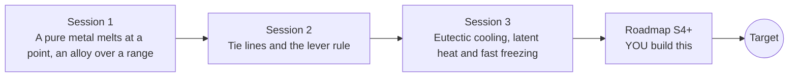

# openphasediagram

[](https://github.com/KrunalPanchal1995/openphasediagram/actions/workflows/ci.yml)   [](https://colab.research.google.com/github/KrunalPanchal1995/openphasediagram/blob/main/sessions/session-01/lesson.ipynb) [](https://krunalpanchal1995.github.io/openphasediagram/)

**Read a phase diagram to pick an alloy and a heat treatment, in three sessions.**

openphasediagram teaches how to read melting maps of alloys, from one cooling curve to the lever rule and a cooling simulation, using only Python and a browser.

- **Start from zero.** Session 1 needs only school arithmetic; a phase diagram is explained as a map of liquid, mush and solid.
- **See it move.** Every session ships a slider app that runs in the browser, with labelled graphs.
- **Know you got it right.** Each session ends with a checkpoint that prints PASS or FAIL against hand calculations and conservation checks.
- **Build the missing half.** The repo stops at Session 3 on purpose; the roadmap shows the path to the Target.

[Target](#the-target) · [Who is this for](#who-is-this-for) · [Quick start](#quick-start) · [Sessions](#sessions) · [Roadmap](#roadmap) · [Contribute](#contribute) · [Explainer PDF](docs/explainer.pdf)

> **This repo is incomplete on purpose.** Sessions 1 to 3 are here and fully working. The finished Target below is a preview of what the community can build next. We show you the path, not the code. Sessions 4 and up are yours.

## The Target

A 30 wt% Sn alloy of a lead-tin-like system cools in a chill mould. On the left, the state point slides down a phase diagram, the tie line stretches and a lever-rule bar shows liquid, primary alpha and eutectic. On the right the matching cooling curve is drawn with its slope change at the liquidus and the flat eutectic arrest, against a dashed Scheil curve for fast freezing: the eutectic share is about 26 percent in equilibrium but about 35 percent with Scheil freezing. Your goal over the coming sessions: build this linked picture yourself, then extend it to heat treatment.


*Target: a moving point on the phase diagram, tie line, lever-rule bars and the matching cooling curve*


*Target still: mid-way through the eutectic arrest*


*Eutectic appears in alloys the diagram says have none when they cool fast*

Try it live:

- [Math Visual Studio (explore curves and graphs)](https://krunalpanchal1995.github.io/studio/)

How the Target was made is shown only as a path in [promo/roadmap.md](promo/roadmap.md).

## Who is this for
**secondary school to diploma / undergraduate (levels 3-5).** Topic area: Chemistry and Materials Science.

Prerequisites:

- School arithmetic, reading a graph, and ratios (percent).
- Python 3.10 or newer; if `python --version` works, you are ready. PRIMER.md explains the rest.
- No prior GitHub, materials science or thermodynamics experience is needed.

New to Python? Read [PRIMER.md](PRIMER.md) first (10 minutes).

## Quick start

No installation knowledge needed. You need [Git](https://git-scm.com/downloads) and [Python 3.10+](https://www.python.org/downloads/) (Windows: tick "Add Python to PATH"). On Mac and Linux type `python3` wherever this page says `python`.

```bash
git clone https://github.com/KrunalPanchal1995/openphasediagram.git
cd openphasediagram
python start.py 1
```

`start.py` creates a private environment, installs what is needed and runs Session 1 with its checkpoint. Next: `python start.py 2`, `python start.py 3`, or `python start.py test` to check everything. Only a checkpoint: `python start.py check 1`.

A few lines turn the idea of Session 2 into a result (they work as they are): Save it as `try.py` and run it with `python start.py run try.py` (this uses the private environment, where NumPy is installed):

```python
import numpy as np
C0, CL, CS = 50.0, 45.7, 64.0           # wt% Ni: alloy, liquid and solid compositions on the tie line
fL = (CS - C0) / (CS - CL)              # lever rule: opposite arm / whole tie line
print(round(float(fL), 3), 'of the alloy is liquid')    # -> 0.763
```

Every session also opens in your browser with sliders (no install): [live apps](https://krunalpanchal1995.github.io/openphasediagram/). Or use the Colab badge above for the notebook.

## Sessions

| # | Session | Model level | Time | Live app |
|---|---|---|---|---|
| 1 | [A pure metal melts at a point, an alloy over a range](sessions/session-01/README.md) | Level 1: conceptual interactive model | 60 min | [open](https://krunalpanchal1995.github.io/openphasediagram/session-01/) |
| 2 | [Tie lines and the lever rule](sessions/session-02/README.md) | Level 2: mathematical engineering model | 75 min | [open](https://krunalpanchal1995.github.io/openphasediagram/session-02/) |
| 3 | [Eutectic cooling, latent heat and fast freezing](sessions/session-03/README.md) | Level 3: simulation and validation | 90 min | [open](https://krunalpanchal1995.github.io/openphasediagram/session-03/) |

Each session follows the same six steps: A real-world problem, B concept and theory, C visual explanation, D interactive simulation, E worked example and experiment, F assessment and design challenge. Each ends with `checkpoint.py`, which prints `PASS` or `FAIL` against reference numbers. Session 3 also contains the real-world mini-project: **Choose a pasty solder: composition and working temperature**.

## Architecture



| Folder or file | What is inside |
|---|---|
| `sessions/` | three sessions: README (A-F), `lesson.py`, notebook, live app, exercises, activity sheet, checkpoint |
| `promo/` | the Target: media, live links, and the roadmap (path only) |
| `docs/` | `explainer.tex` and the built `explainer.pdf` |
| `tests/` | runs every lesson and checkpoint headless |
| `start.py` | one command to set up and run anything |
| `QUALITY.md`, `RUBRIC.md` | the quality checklist and the scoring rubric |
| `.github/` | CI, PDF build, Pages deploy, issue and PR templates |

## Roadmap

| Milestone | What you will build | Difficulty |
|---|---|---|
| Session 4: Homogenising anneal | A solid-state diffusion model across one dendrite arm with a heat treatment time. | intermediate |
| Session 5: Fit a diagram from cooling curves | An inverse tool that reads simulated noisy cooling curves of several alloys and rebuilds the diagram. | intermediate |
| Session 6: Peritectic and intermetallic diagrams | A second diagram type with a peritectic and a compound, with phase fractions on both sides of the line. | advanced |
| Session 7: A moving freezing front | A one-dimensional ingot with a heat-flow solver and the lever-rule enthalpy. | advanced |
| Session 8: Quench and age: a heat treatment | A quench-then-age calculation using a solvus line that falls with temperature. | advanced |

Full detail with a checkpoint per milestone: [promo/roadmap.md](promo/roadmap.md).

## Contribute
New to GitHub? Read [CONTRIBUTING.md](CONTRIBUTING.md); it starts from zero. Pick an issue labelled `good first issue`. Translations into Hindi, Telugu, Tamil and Malayalam are welcome.

<details>
<summary>Development</summary>

```bash
python start.py test        # runs every lesson and checkpoint
```
Lessons use `# %%` cell markers so they open as notebooks in VS Code. See [QUALITY.md](QUALITY.md) for the standard every session meets.
</details>

## License
MIT. See [LICENSE](LICENSE). Media in `promo/media` is (c) Krunal Panchal, CC BY 4.0.

## Acknowledgments
Part of the [PAN IIT OSS](https://hellofoss.tech-iitb.org/projects) open-source teaching collection, modelled on the structure of [openspline](https://github.com/openspline/openspline). Built on ideas from the Math Visual Studio at https://krunalpanchal1995.github.io/studio/.
