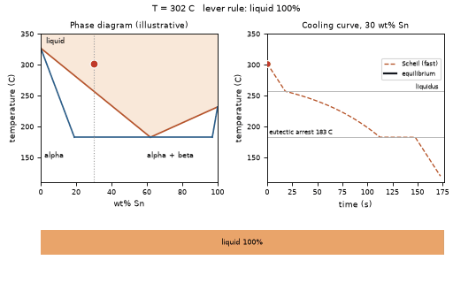
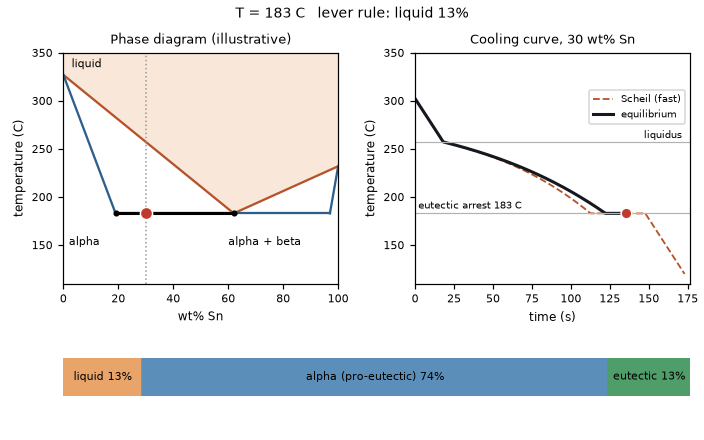
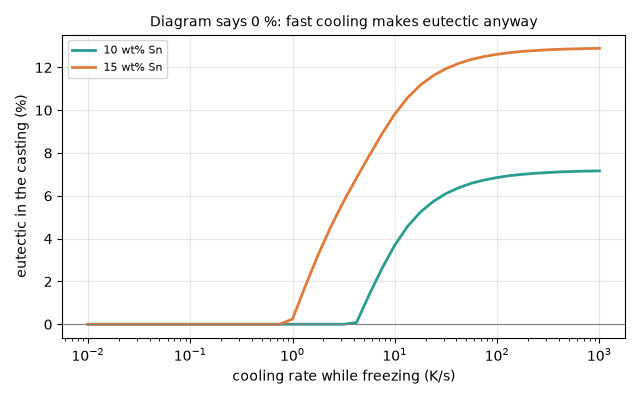

# What you are building toward

A 30 wt% Sn alloy of a lead-tin-like system cools in a chill mould. On the left, the state point slides down a phase diagram, the tie line stretches and a lever-rule bar shows liquid, primary alpha and eutectic. On the right the matching cooling curve is drawn with its slope change at the liquidus and the flat eutectic arrest, against a dashed Scheil curve for fast freezing: the eutectic share is about 26 percent in equilibrium but about 35 percent with Scheil freezing. Your goal over the coming sessions: build this linked picture yourself, then extend it to heat treatment.

*Target: a moving point on the phase diagram, tie line, lever-rule bars and the matching cooling curve*

*Target still: mid-way through the eutectic arrest*

*Eutectic appears in alloys the diagram says have none when they cool fast*

These results come from a private reference build. The code is not published; the roadmap shows the path so you can build your own.

Live links:

- [Math Visual Studio (explore curves and graphs)](https://krunalpanchal1995.github.io/studio/)
