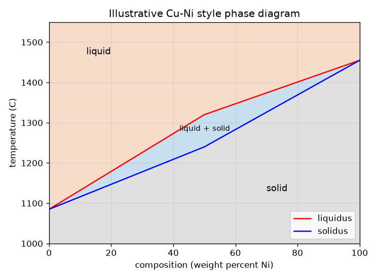
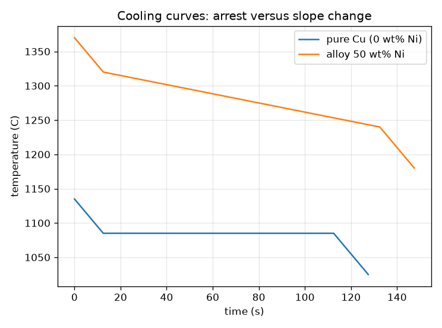

# Session 1: A pure metal melts at a point, an alloy over a range

*Level 1 (conceptual interactive model) · about 60 minutes · openphasediagram*

> This is a simplified educational model. It is not a validated design tool and must not be used for real structures, electrical installations, vehicles, industrial processes or medical decisions.

**Prerequisites**

- Reading a graph with temperature on one axis.
- You have read PRIMER.md and run `python start.py 1` once.

**Learning objectives.** After this session you can:

- Explain why a pure metal melts at one temperature and an alloy over a range.
- Read the liquid, liquid + solid and solid regions of a simple two-metal phase diagram.
- Read a cooling curve: a flat arrest for a pure metal, bends for an alloy.
- Use the diagram to choose an alloy that is liquid at one temperature and solid at another.

## A. Real-world problem
A bar of pure copper stays hard until one exact temperature and then melts. The solder in a plumber's kit goes soft and pasty first and only later runs like water. A phase diagram is the map that tells you which state an alloy is in at every temperature and composition. How do we read it, and how does it show up when a melt cools?

## B. Concept and theory
A phase is a uniform region of material, here liquid or solid. The diagram plots composition on the horizontal axis (weight percent of nickel, metal B) and temperature on the vertical axis. The liquidus is the line above which the alloy is completely liquid; the solidus is the line below which it is completely solid. Between them lies a two-phase band where liquid and solid coexist, known as the mushy zone. Pure metals sit at the two outer edges (0 wt% and 100 wt% Ni) where the liquidus and solidus meet, which is why pure metals melt at a single fixed temperature. When heat is taken out of a melt at a steady rate, the temperature falls steadily in the liquid; while the metal freezes it gives up latent heat (the heat released during freezing), so the cooling curve flattens. A pure metal displays a flat thermal arrest; an alloy only bends. Here the heat content per gram is H = c T + L (1 - f), where f is the fraction frozen, and time = heat removed divided by the heat removal rate.

| Symbol | Meaning | Unit |
|---|---|---|
| x | composition: weight percent Ni | wt% |
| T | temperature | °C |
| T_L, T_S | liquidus and solidus temperatures | °C |
| c | specific heat (0.5 here, illustrative) | J/(g K) |
| L | latent heat of freezing (200 here, illustrative) | J/g |
| Q | heat removal rate per gram (2 here) | W/g |
| f | fraction frozen (linear between liquidus and solidus in this session) | no unit |

**Assumptions**

- The diagram is an illustration: straight-line pieces between Cu 1085 C and Ni 1455 C, not the measured Cu-Ni diagram.
- One value of c and L for all phases and compositions.
- Heat is removed at a steady rate and the whole piece has one temperature (lumped).
- Pure metals melt at 1085 C (Cu) and 1455 C (Ni).

$$ T_S(x)\le T\le T_L(x)\ \Rightarrow\ \text{liquid}+\text{solid};\quad T>T_L\Rightarrow\text{liquid};\quad T<T_S\Rightarrow\text{solid} $$

$$ \Delta T_{\text{range}}=T_L(x)-T_S(x)\quad(=0\ \text{for a pure metal}) $$

$$ H(T)=c\,T+L\,\bigl(1-f(T)\bigr),\qquad t=\dfrac{H_{\text{start}}-H(T)}{Q} $$

$$ \text{arrest of a pure metal}=\dfrac{L}{Q} $$

## C. Visual explanation
The first figure is the simplified diagram: orange liquid on top, a blue band of liquid + solid and grey solid below, with the liquidus and solidus meeting at the two pure metals. The second figure shows two cooling curves for the same heat loss. Pure copper falls, sits flat at 1085 C for 100 s while it freezes, then falls again. The 50 wt% Ni alloy begins freezing at 1320 C and finishes at 1240 C, and in between it cools more slowly (about 0.67 K/s instead of 4 K/s) with no flat part.

*Illustrative Cu-Ni style diagram: liquid, a two-phase band and solid.*

*Pure copper holds a flat arrest; the 50 wt% Ni alloy only bends.*

## D. Interactive simulation
Run the lesson (`python start.py 1`), then open the live app: [Session 1: where is the alloy, and how does it cool?](https://krunalpanchal1995.github.io/openphasediagram/session-01/) (or `app.html` in this folder). Move the composition and temperature sliders and watch which region the point falls in. Then open the cooling-curve view and compare a pure metal (0 wt% Ni) with a 50 wt% alloy.

**Challenge.** Put a 50 wt% Ni alloy at a temperature where it is part liquid and part solid.

## E. Worked example and experiment
**Problem.** For the 50 wt% Ni alloy find the melting range, say which phase region it is in at 1280 C, and compare how long the pure copper arrest lasts (L = 200 J/g, Q = 2 W/g).

1. Read the diagram at 50 wt% Ni: liquidus 1320 C, solidus 1240 C.
2. Melting range = 1320 - 1240 = 80 K.
3. At 1280 C we have 1240 < 1280 < 1320, so the alloy is liquid + solid.
4. Pure copper: the latent heat L = 200 J/g leaves at Q = 2 W/g, so the arrest lasts 200 / 2 = 100 s.
5. The alloy crosses its range in (0.5 * 80 + 200) / 2 = 120 s, an average rate of 80 / 120 = 0.67 K/s, against 2 / 0.5 = 4 K/s in the liquid.

**Answer.** The melting range is 80 K, the alloy is liquid + solid at 1280 C, pure copper holds a 100 s arrest, and the alloy cools at 0.67 K/s through its range.

**Experiment.** With an adult, melt a little pure tin and, separately, a non-eutectic plumbing solder in a small steel cup on a hot plate (ventilation, gloves, no lead for children), insert a thermometer, let each cool and record the temperature every 10 s. Pure tin shows a flat part; the solder only bends. Real curves round off the corners and may dip below the freezing point first (undercooling), because the model has no heat flow inside the sample. Take hot-surface precautions.

## F. Assessment and design challenge
**Question type A: Conceptual.** Why does a pure metal show a flat part on its cooling curve while an alloy only bends?

Hint

Where do the liquidus and solidus meet, and what does the latent heat have to do?

Step-by-step solution

A pure metal has liquidus = solidus, so all of the latent heat is released at a single temperature; the temperature cannot fall until it has all frozen, which gives a flat arrest. An alloy freezes over a range: only a little latent heat is released per degree, so the cooling is slowed (the curve bends to a lower slope) but never stops.

**Question type B: Numerical.** How long does the 50 wt% Ni alloy take to cool from 1320 C to 1240 C at Q = 2 W/g with c = 0.5 J/(g K) and L = 200 J/g? What is the mean cooling rate there?

Hint

Heat to remove = c times the temperature drop plus the latent heat L, then divide by Q.

Step-by-step solution

Heat = 0.5 * 80 + 200 = 240 J/g. Time = 240 / 2 = 120 s. Mean rate = 80 K / 120 s = 0.67 K/s. Sanity check: it is slower than the liquid rate Q/c = 4 K/s, as latent heat is being released.

**Question type C: Graph and simulation interpretation.** On the cooling-curve view, where does the curve for 50 wt% Ni change slope, and at which temperatures?

Hint

Look for the two corners of the curve.

Step-by-step solution

It bends at 1320 C (the liquidus: first crystals, latent heat begins to be released, the curve flattens) and at 1240 C (the solidus: freezing is complete, the curve steepens again to the solid cooling rate). Between the two corners it falls more slowly but continuously, unlike pure copper whose curve is flat at 1085 C.

**Question type D: Design and optimisation challenge.** Design: a brazing filler must be completely liquid at 1350 C and completely solid at 1200 C. Using this diagram, which Ni contents work (whole numbers)? Are pure Cu or pure Ni possible?

Hint

Need liquidus <= 1350 and solidus >= 1200. Solve each with the straight line pieces.

Step-by-step solution

The solidus must be at least 1200 C: 1085 + 3.1 x >= 1200 gives x >= 37.1, so x >= 38. The liquidus must be at most 1350 C: 1320 + 2.7 (x - 50) <= 1350 gives x <= 61.1, so x <= 61. Alloys from 38 to 61 wt% Ni work. Pure Cu is already liquid at 1200 C, pure Ni is still solid at 1350 C, so neither works. Trade-off: the middle of the window (about 50 wt%) has the most margin in both limits. Assumption: the diagram is only illustrative.

Score yourself with [RUBRIC.md](../../RUBRIC.md). Print the [activity sheet](activity_sheet.md) to work on paper.

## Common misconceptions
| Common misconception | What is actually true |
|---|---|
| Every material has one melting point. | Pure metals do; alloys melt over a range between the solidus and the liquidus. |
| The temperature always drops while a metal freezes. | While it freezes, the latent heat released slows or stops the drop; a pure metal stays flat. |
| The two-phase band is a half-melted lump of the same stuff. | It is a mixture of two phases with different compositions; Session 2 shows how to read both. |
| The diagram in this repo is the real Cu-Ni diagram. | It is a simplified illustration with straight-line pieces; real boundaries are curved and measured. |

## Glossary
- **phase**: a uniform region of material, such as the liquid or a solid
- **liquidus**: the line above which an alloy is completely liquid
- **solidus**: the line below which an alloy is completely solid
- **latent heat**: heat released when a liquid freezes without a change of temperature
- **arrest**: a flat part of a cooling curve while a pure metal freezes
- **alloy**: a metal made by mixing metals (or a metal with other elements)

## Finish
1. Do the three coding tasks in [exercises.md](exercises.md).
2. Run `python start.py 1` again after your changes. It ends with the checkpoint; when it prints `PASS`, you are done. (Checkpoint only: `python start.py check 1`.)

Next: [Session 2](../session-02/README.md)
