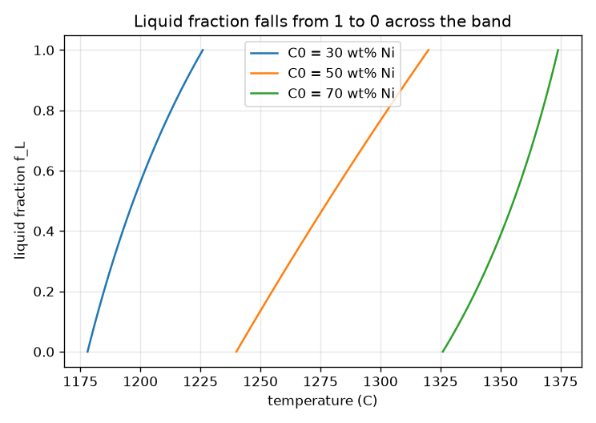
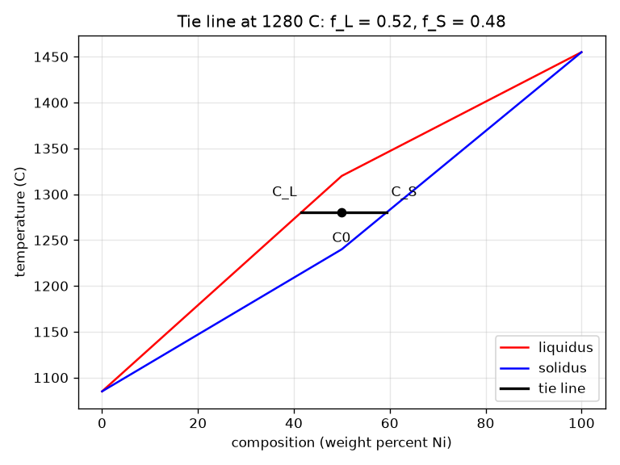

# Session 2: Tie lines and the lever rule

*Level 2 (mathematical engineering model) · about 75 minutes · openphasediagram*

> This is a simplified educational model. It is not a validated design tool and must not be used for real structures, electrical installations, vehicles, industrial processes or medical decisions.

**Prerequisites**

- Session 1: liquidus, solidus and the two-phase band.
- Solving a linear equation for one unknown.

**Learning objectives.** After this session you can:

- Read the composition of each phase from a tie line.
- Derive the lever rule from conservation of the solute.
- Compute liquid and solid fractions at any point in the two-phase band.
- Solve a design problem: which composition and temperature give a wanted liquid fraction?

## A. Real-world problem
A foundry wants a casting that is exactly half liquid and half solid, a slurry that can be pressed into shape. At a given temperature the liquid and the solid in the band do not have the same composition as the alloy. How much of each is there, what is each made of, and which alloy and temperature give 50 percent liquid?

## B. Concept and theory
Take an alloy of overall composition C0 inside the two-phase band at temperature T. A horizontal tie line at T meets the liquidus at C_L (the composition of the liquid) and the solidus at C_S (the composition of the solid). The solute is conserved: the amount in the liquid plus the amount in the solid is the total, C0 = f_L C_L + f_S C_S with f_L + f_S = 1. Solving gives the lever rule: the fraction of a phase is the opposite arm of the tie line divided by the whole tie line. As the alloy cools, f_L falls from 1 at the liquidus to 0 at the solidus, and the phase compositions slide along the two lines. The inverse problem has two ways to be posed: fix C0 and find T by solving f_L = target, or fix T and find C0, which for a half-liquid alloy is the middle of the tie line.

| Symbol | Meaning | Unit |
|---|---|---|
| C0 | overall composition of the alloy | wt% Ni |
| C_L | composition of the liquid at T (on the liquidus) | wt% Ni |
| C_S | composition of the solid at T (on the solidus) | wt% Ni |
| f_L, f_S | mass fractions liquid and solid | no unit |
| T | temperature of the tie line | C |

**Assumptions**

- Illustrative straight-line pieces between Cu 1085 C and Ni 1455 C.
- Equilibrium: at each temperature the phases have had time to reach the compositions on the tie line.
- Weight (mass) fractions, composition in weight percent.
- No other phases.

$$ C_0 = f_L\,C_L + f_S\,C_S,\qquad f_L+f_S=1 $$

$$ f_L=\dfrac{C_S-C_0}{C_S-C_L},\qquad f_S=\dfrac{C_0-C_L}{C_S-C_L} $$

$$ f_L=\tfrac12\ \Rightarrow\ C_0=\dfrac{C_L+C_S}{2} $$

## C. Visual explanation
The first figure shows the diagram with a tie line at 1280 C for a 50 wt% Ni alloy: the left end touches the liquidus at 41.5 wt% Ni, the right end touches the solidus at 59.3 wt% Ni and the alloy point divides the line into two arms. The second figure plots the liquid fraction against temperature for three alloys; each falls from 1 to 0 across its own band, steeply near the solidus.

*Liquid fraction against temperature for three alloys.*

*A tie line at 1280 C: the liquid is 41.5 wt% Ni, the solid 59.3 wt% Ni.*

## D. Interactive simulation
Run the lesson (`python start.py 2`), then open the live app: [Session 2: tie line and lever rule](https://krunalpanchal1995.github.io/openphasediagram/session-02/) (or `app.html` in this folder). Slide the temperature through the band and watch the tie line, the lever bar and the readout change. In the second view see the liquid fraction fall from 1 to 0.

**Challenge.** Find a composition of at least 60 wt% Ni and a temperature where the mixture is half liquid (within 3 percentage points).

## E. Worked example and experiment
**Problem.** A 50 wt% Ni alloy sits at 1300 C. Find the compositions of the liquid and the solid and the fraction that is liquid.

1. Liquidus piece from (0, 1085) to (50, 1320): C_L = 50 * (1300 - 1085) / (1320 - 1085) = 45.7 wt% Ni.
2. Solidus piece from (50, 1240) to (100, 1455): C_S = 50 + 50 * (1300 - 1240) / (1455 - 1240) = 64.0 wt% Ni.
3. f_L = (C_S - C0) / (C_S - C_L) = (64.0 - 50) / (64.0 - 45.7) = 0.766 (76.6 percent liquid).
4. Check by mass balance: 0.766 * 45.7 + 0.234 * 64.0 = 50.0 wt% Ni. It returns C0, as it must.

**Answer.** The liquid is 45.7 wt% Ni, the solid is 64.0 wt% Ni, and 76.6 percent of the alloy is liquid.

**Experiment.** Quench small samples of one alloy from different temperatures in the two-phase band and measure how much of the sample is solid under a microscope (area fraction). The model is equilibrium: a real sample cooled quickly shows more liquid frozen late and a non-uniform solid, so measured fractions differ from the lever rule (Session 3). Also measuring composition needs a probe such as EDS, which has its own error of a percent or so.

## F. Assessment and design challenge
**Question type A: Conceptual.** Why is the liquid fraction given by the arm to the far end of the tie line (C_S - C0) and not the near arm?

Hint

Think of C0 sliding towards C_L: what should the liquid fraction do?

Step-by-step solution

If C0 moves towards C_L, the alloy is nearly all liquid, so f_L must approach 1. The arm C_S - C0 is then nearly the whole tie line and f_L = (C_S - C0)/(C_S - C_L) approaches 1. The lever balances like a seesaw: the phase whose composition is closer to C0 is the more plentiful, and its weight is the far arm.

**Question type B: Numerical.** For a 30 wt% Ni alloy at 1200 C, find C_L, C_S and the liquid fraction.

Hint

Read the compositions sideways: at 1200 C the liquidus piece is 0 to 50 wt% Ni and the solidus piece is 0 to 50 wt% Ni.

Step-by-step solution

C_L = 50 * (1200 - 1085) / (1320 - 1085) = 24.5 wt% Ni. C_S = 50 * (1200 - 1085) / (1240 - 1085) = 37.1 wt% Ni. f_L = (37.1 - 30) / (37.1 - 24.5) = 0.562. Sanity check: 30 lies between 24.5 and 37.1, and is a little closer to the middle of the tie line than to the solid end, giving a fraction near one half.

**Question type C: Graph and simulation interpretation.** On the liquid-fraction graph, which alloy of 30, 50 and 70 wt% Ni has the widest temperature band? What does the steepness of a curve tell you?

Hint

Read the temperature where each curve starts at 1 and where it reaches 0.

Step-by-step solution

The 50 wt% Ni alloy has the widest band, 80 K, because the liquidus and solidus are furthest apart there. A steep curve means the fraction changes quickly with temperature, so a small temperature change gives a large change in the amount of liquid; that is a poor choice for a process that needs a stable slurry.

**Question type D: Design and optimisation challenge.** Design: at 1300 C which alloy composition is exactly half liquid? Which temperature makes a 50 wt% Ni alloy half liquid? Give a second pair that works.

Hint

At fixed T, half liquid means C0 is the midpoint of the tie line. At fixed C0, solve f_L = 0.5 for T.

Step-by-step solution

At 1300 C: C_L = 45.7, C_S = 64.0, so C0 = (45.7 + 64.0) / 2 = 54.8 wt% Ni. For C0 = 50 wt% Ni: half liquid at 1278.2 C. A second pair: 70 wt% Ni at 1355.5 C, or at 1250 C and 1350 C the alloys 43.7 and 68.3 wt% Ni. Trade-off: the higher the temperature, the more Ni is needed, and a steep f_L curve means tight temperature control is needed.

Score yourself with [RUBRIC.md](../../RUBRIC.md). Print the [activity sheet](activity_sheet.md) to work on paper.

## Common misconceptions
| Common misconception | What is actually true |
|---|---|
| The liquid and the solid in the band have the same composition as the alloy. | Each has the composition at the ends of the tie line; only their average equals the alloy composition. |
| The lever rule gives the fraction of a phase from the near arm. | It is the opposite (far) arm divided by the whole tie line. |
| The lever rule works in any region of the diagram. | It applies only inside a two-phase region and gives fractions of those two phases. |
| Fractions are in atomic percent. | Here they are mass fractions with composition in weight percent; atomic percent would need a conversion. |

## Glossary
- **tie line**: a horizontal line at one temperature across a two-phase band, connecting the two phase compositions
- **lever rule**: phase fraction = opposite arm of the tie line divided by the whole tie line
- **mass balance**: the solute in the alloy equals the solute in all phases together
- **isomorphous**: a diagram in which the two metals mix completely in both liquid and solid
- **weight percent**: mass of one element divided by the total mass, times 100

## Finish
1. Do the three coding tasks in [exercises.md](exercises.md).
2. Run `python start.py 2` again after your changes. It ends with the checkpoint; when it prints `PASS`, you are done. (Checkpoint only: `python start.py check 2`.)

Next: [Session 3](../session-03/README.md)
