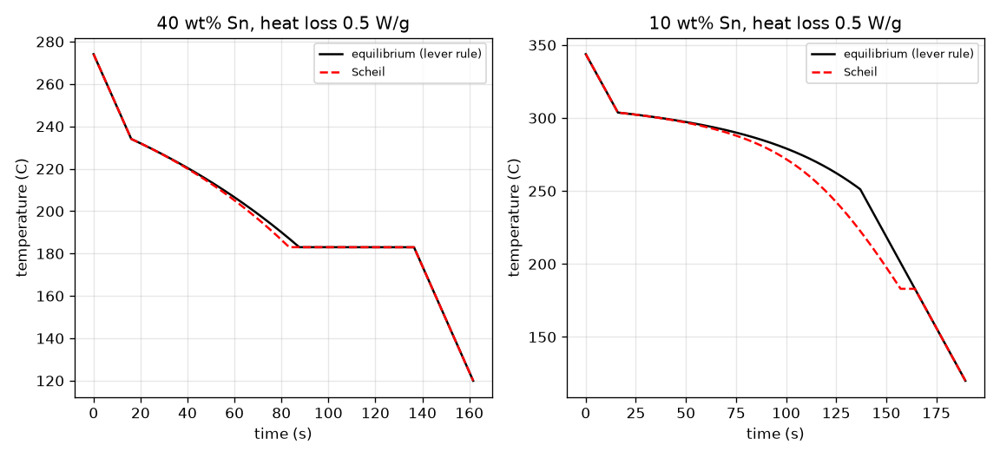
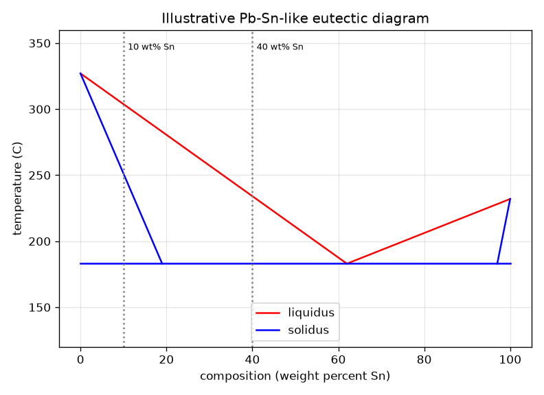
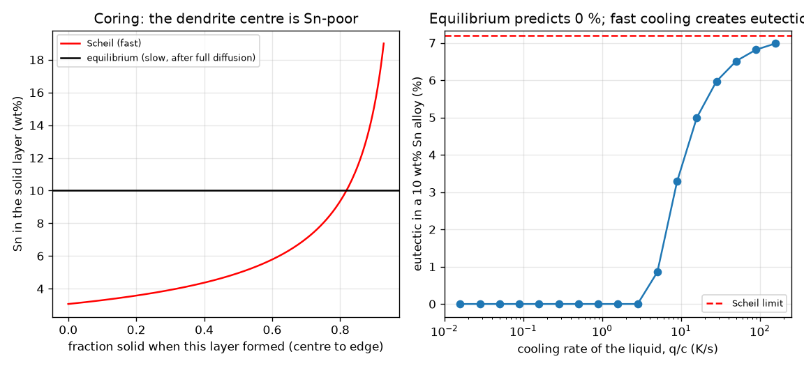

# Session 3: Eutectic cooling, latent heat and fast freezing

*Level 3 (simulation and validation) · about 90 minutes · openphasediagram*

> This is a simplified educational model. It is not a validated design tool and must not be used for real structures, electrical installations, vehicles, industrial processes or medical decisions.

**Prerequisites**

- Session 2: the lever rule.
- Session 1: cooling curves and latent heat.

**Learning objectives.** After this session you can:

- Describe a eutectic diagram: the lowest melting temperature, pro-eutectic phase plus eutectic mixture.
- Simulate a cooling curve with latent heat using an energy balance and the lever-rule fraction solid.
- Validate the simulation against lever-rule fractions and energy conservation.
- Compare Scheil (fast) with equilibrium freezing and explain coring.
- Find the cooling rate at which the equilibrium assumption fails.

## A. Real-world problem
Electronics solder melts at a low temperature because tin and lead form a eutectic: a composition that melts lower than either metal. A factory joint may freeze in a fraction of a second, too fast for atoms to move as the lever rule assumes. The joint then contains a different structure than the diagram predicts, with a non-uniform composition inside each grain. How can we simulate the cooling curve, and when does equilibrium fail?

## B. Concept and theory
The illustrative lead-rich side has a liquidus falling from 327 C (pure Pb) to the eutectic at 183 C and 62 wt% Sn, and an alpha solidus reaching 19 wt% Sn at 183 C. Because both lines start at pure Pb, the ratio of solid to liquid composition on every tie line is constant, k = 19 / 62 = 0.306 (the partition coefficient). An alloy between 19 and 62 wt% Sn first grows pro-eutectic alpha above 183 C, then the remaining liquid at 62 wt% Sn freezes all at once at 183 C into the eutectic mixture. Cooling simulation: the heat content per gram H(T) = c T + L (1 - f_s(T)), with f_s the lever-rule solid fraction; heat leaves at rate q so H falls by q dt each step and the temperature is found by inverting H(T). The curve bends at the liquidus (the effective heat capacity is c + L |df_s/dT|) and is flat during the eutectic arrest. Scheil freezing assumes no diffusion in the solid and a perfectly mixed liquid; mass balance gives C_L = C0 f_L^(k-1). The Clyne-Kurz model adds limited back-diffusion through alpha = D t_f / lambda^2 and interpolates between Scheil and the lever rule.

| Symbol | Meaning | Unit |
|---|---|---|
| C0 | alloy composition | wt% Sn |
| k | partition coefficient, C_solid / C_liquid (19/62) | no unit |
| f_s, f_L | solid and liquid fractions | no unit |
| c | specific heat (0.2, illustrative) | J/(g K) |
| L | latent heat (50, illustrative) | J/g |
| q | heat removal rate | W/g |
| D | diffusion coefficient of Sn in solid alpha (1e-12, illustrative) | m^2/s |
| lambda | half the dendrite arm spacing (20e-6, illustrative) | m |
| t_f | local freezing time | s |
| alpha, a' | back-diffusion parameters | no unit |

**Assumptions**

- Illustrative Pb-Sn-like numbers with straight lines (not measured data): 327 C, 183 C, 62, 19 and 97 wt% Sn.
- Lumped cooling: one temperature for the whole casting; real castings freeze from the wall inward.
- Constant c and L for all phases; heat removal q either constant or Newtonian.
- Perfectly mixed liquid; no undercooling; constant k; Scheil and Clyne-Kurz are limiting models.
- Diffusion data and arm spacing are order-of-magnitude illustrations (the arm spacing really depends on cooling rate).

$$ f_s^{\text{pro}}=\dfrac{62-C_0}{62-19},\qquad f_{\text{eut}}=\dfrac{C_0-19}{62-19}\quad(19\le C_0\le 62) $$

$$ H(T)=c\,T+L\,\bigl(1-f_s(T)\bigr),\qquad H_{n+1}=H_n-q\,\Delta t,\qquad c_{\text{eff}}=c+L\left|\dfrac{df_s}{dT}\right| $$

$$ (1-f_s)\,dC_L=(1-k)\,C_L\,df_s\ \Rightarrow\ C_L=C_0\,f_L^{\,k-1},\quad C_S=k\,C_L $$

$$ f_{\text{eut}}^{\text{Scheil}}=\left(\dfrac{62}{C_0}\right)^{1/(k-1)} $$

$$ \alpha=\dfrac{D\,t_f}{\lambda^2},\quad a'=\alpha\left(1-e^{-1/\alpha}\right)-\tfrac12 e^{-1/(2\alpha)},\quad C_L=C_0\left[1-(1-2a'k)f_s\right]^{\frac{k-1}{1-2a'k}} $$

## C. Visual explanation
Figure 1 is the Pb-Sn-like diagram with two alloys marked. Figure 2 shows the simulated cooling curves of 40 and 10 wt% Sn: a slope change at the liquidus, then a flat eutectic arrest at 183 C (equilibrium: 48.8 s for 40 wt% Sn; none for 10 wt% Sn), against a dashed Scheil curve that has a 7.2 s arrest even for 10 wt% Sn. Figure 3 shows the coring profile of the 10 wt% Sn alloy (the centre of a dendrite is 3.06 wt% Sn, the edge 19) and how the eutectic share grows with cooling rate from 0 percent to the Scheil limit of 7.2 percent.

*Simulated cooling curves: equilibrium (black) and Scheil (red dashed).*

*Illustrative Pb-Sn-like diagram with the alloys 10 and 40 wt% Sn.*

*Coring profile of a 10 wt% Sn alloy and eutectic fraction against cooling rate.*

## D. Interactive simulation
Run the lesson (`python start.py 3`), then open the live app: [Session 3: eutectic cooling, Scheil and cooling rate](https://krunalpanchal1995.github.io/openphasediagram/session-03/) (or `app.html` in this folder). Slide the composition and the heat-removal rate and watch the cooling curves (equilibrium and Scheil), the Sn profile across a dendrite and the eutectic fractions in the readout.

**Challenge.** Cool a 10 wt% Sn alloy fast enough that at least 5 percent of it freezes as eutectic (the equilibrium diagram predicts none).

## E. Worked example and experiment
**Problem.** A 40 wt% Sn alloy is cooled at q = 0.5 W/g from 40 C above its liquidus. Find the liquidus, the fractions of pro-eutectic alpha and eutectic, the time to reach the liquidus and the length of the eutectic arrest.

1. Liquidus: T_L = 327 - (144 / 62) * 40 = 234.1 C.
2. Just above 183 C the lever rule with C_L = 62 and C_S = 19 gives pro-eutectic alpha = (62 - 40) / (62 - 19) = 0.512 (51.2 percent). The remaining liquid, 48.8 percent, becomes the eutectic mixture.
3. In the liquid the temperature falls at q / c = 0.5 / 0.2 = 2.5 K/s, so the first 40 C take c * 40 / q = 16 s.
4. At 183 C the latent heat of the remaining liquid leaves at constant temperature: the arrest lasts L * 0.488 / q = 50 * 0.488 / 0.5 = 48.8 s.
5. Check the simulation: it reproduces these times, its frozen fraction equals the lever rule between 234 and 183 C, and total heat removed equals c times the temperature drop plus L.

**Answer.** Liquidus 234.1 C; 51.2 percent pro-eutectic alpha and 48.8 percent eutectic; 16 s to reach the liquidus; a 48.8 s eutectic arrest.

**Experiment.** Pour molten 60/40 or lead-free solder into a small metal cup with a thermocouple (use a hot plate, ventilation and gloves) and record temperature every second while it cools. Look for the slope change at the liquidus and the flat arrest. Model versus reality: real alloys undercool a few kelvin before the arrest, the thermocouple and the cup add heat capacity, and the diagram here is illustrative, so the numbers will differ even though the shape matches.

## Real-world application and mini-project: Choose a pasty solder: composition and working temperature
A plumber's wiping solder must be 60 percent liquid when it is worked, and the working temperature must not exceed 230 C. Using the illustrative Pb-Sn-like diagram and the lever rule from Session 3 (`temperature_for_liquid_fraction`), find the smallest whole-number tin content that meets both limits.

**Deliverable:** A script that prints, for tin contents from 20 to 44 wt% Sn, the temperature at which the alloy is 60 percent liquid, names the smallest whole wt% Sn whose temperature is at most 230 C, and saves a plot of temperature against composition with the 230 C limit.

**Success looks like:** The answer is 31 wt% Sn, 60 percent liquid at 227.4 C (30 wt% Sn needs 230.6 C and fails). Note in two sentences what fast cooling of this joint would change (Scheil freezing makes more eutectic).

## F. Assessment and design challenge
**Question type A: Conceptual.** A 10 wt% Sn alloy is single-phase alpha in the equilibrium diagram. Why does a fast-cooled joint of this alloy still contain some eutectic?

Hint

Think about what happens to the Sn rejected by the first solid, and whether it can diffuse back.

Step-by-step solution

Each layer of solid that forms is poorer in Sn (k C_L) than the liquid and rejects the extra Sn into the liquid. With fast cooling the Sn cannot diffuse back into the solid, so the liquid keeps getting richer in Sn until it reaches the eutectic composition, 62 wt% Sn, and freezes as eutectic. The centre of each dendrite stays Sn-poor (coring) and the last liquid forms eutectic between dendrites.

**Question type B: Numerical.** Using the Scheil equation, find the liquid composition for a 10 wt% Sn alloy when 90 percent has frozen, and then the fraction of eutectic it forms.

Hint

C_L = C0 f_L^(k-1) with k = 19/62 and f_L = 0.1. For the eutectic set C_L = 62.

Step-by-step solution

k - 1 = -0.6935. C_L = 10 * 0.1^(-0.6935) = 49.4 wt% Sn (between 10 and 62, as expected). The eutectic fraction is f_L = (62 / 10)^(1/(k-1)) = 6.2^(-1.442) = 0.072, so 7.2 percent. The equilibrium diagram predicts 0 percent.

**Question type C: Graph and simulation interpretation.** On the eutectic-versus-cooling-rate graph, at which cooling rates does the eutectic stay zero, and what limit does the curve approach at high rates?

Hint

Read the plateau at slow rates and at fast rates.

Step-by-step solution

For a 10 wt% Sn alloy the eutectic is 0 percent at slow rates (0.005 and 0.5 W/g, that is up to about 2.5 K/s in the liquid), appears as the rate rises (5.8 percent at 5 W/g) and approaches the Scheil limit of 7.2 percent (7.1 percent at 50 W/g). The reason: a high rate shortens the freezing time, so the diffusion parameter alpha falls and the solid behaves as if it could not exchange Sn at all.

**Question type D: Design and optimisation challenge.** Design: choose the smallest whole-number Sn content whose liquid fraction is 60 percent at or below 230 C, and state the temperature. Why is the result not valid for fast-cooled solder?

Hint

Use the lever rule between the liquidus and 183 C; find f_L = 0.6 for several compositions.

Step-by-step solution

30 wt% Sn needs 230.6 C (too hot), 31 wt% Sn needs 227.4 C, so 31 wt% Sn is the smallest that works. This is an equilibrium result: fast heating or cooling of a real joint leaves more eutectic (35.1 percent against 25.6 percent for 30 wt% Sn), which changes how much liquid there is at a given temperature. Treat the number as an illustration, not as a solder specification.

Score yourself with [RUBRIC.md](../../RUBRIC.md). Print the [activity sheet](activity_sheet.md) to work on paper.

## Common misconceptions
| Common misconception | What is actually true |
|---|---|
| The phase diagram tells you the structure of any casting. | It gives the equilibrium structure; fast cooling gives different fractions and non-uniform grains. |
| A eutectic has a melting range like other alloys. | A eutectic composition melts at a single temperature, with a flat arrest like a pure metal, and that temperature is lower than either pure metal's. |
| Latent heat does not matter for the cooling curve. | It is why the curve bends at the liquidus and is flat at the eutectic; ignoring it would give a smooth exponential. |
| Scheil freezing is always the right model for castings. | It is the fast limit; real freezing lies between Scheil and the lever rule, set by the diffusion parameter alpha. |

## Glossary
- **eutectic**: the composition and temperature at which a liquid freezes completely into a fine mixture of two solids at a single, lowest temperature
- **pro-eutectic phase**: solid that forms before the eutectic freezes, such as primary alpha
- **enthalpy method**: a way to simulate freezing by tracking heat content and converting it to temperature
- **Scheil equation**: composition of the liquid when the solid does not diffuse: C_L = C0 f_L^(k-1)
- **partition coefficient**: ratio of solute in the solid to that in the liquid at the interface
- **coring**: composition variation from centre to edge of a dendrite caused by fast freezing
- **dendrite**: a tree-like crystal that grows as a melt freezes
- **undercooling**: cooling a liquid below its freezing point before it starts to freeze

## Finish
1. Do the three coding tasks in [exercises.md](exercises.md).
2. Run `python start.py 3` again after your changes. It ends with the checkpoint; when it prints `PASS`, you are done. (Checkpoint only: `python start.py check 3`.)

Next: the [roadmap](../../promo/roadmap.md). Session 4 is yours to build.
